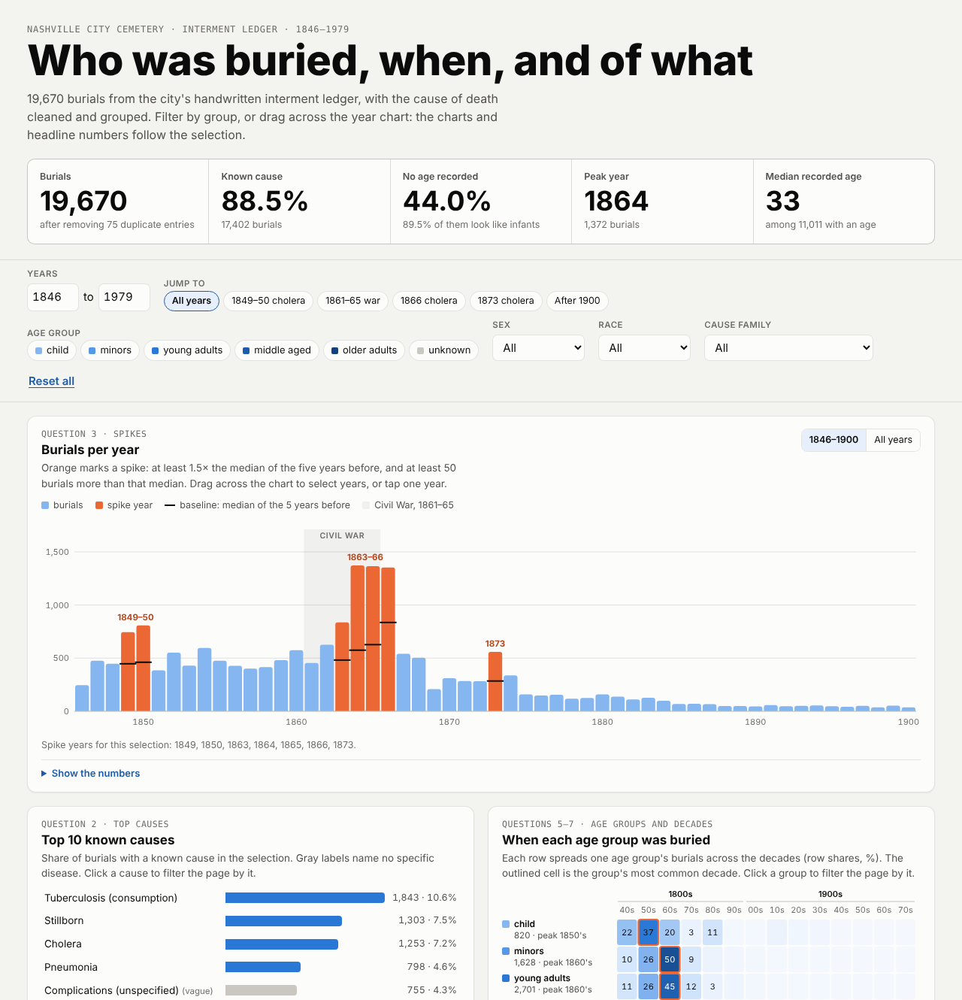
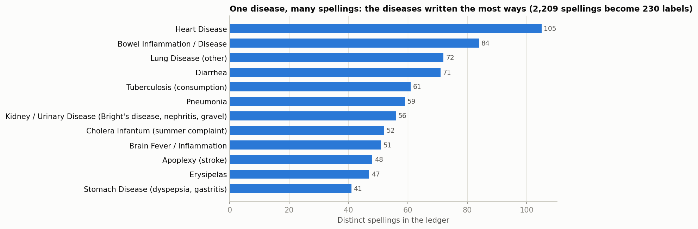
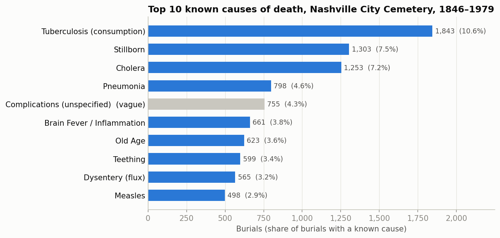
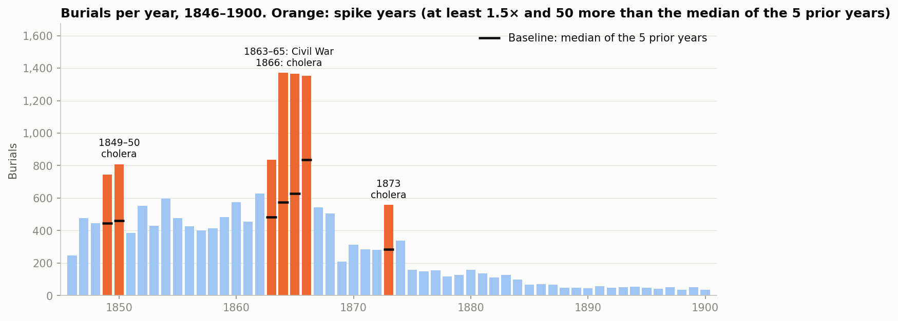
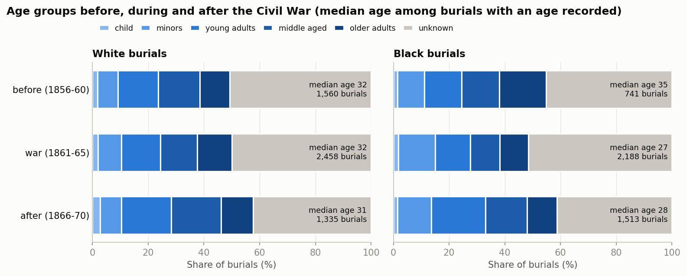
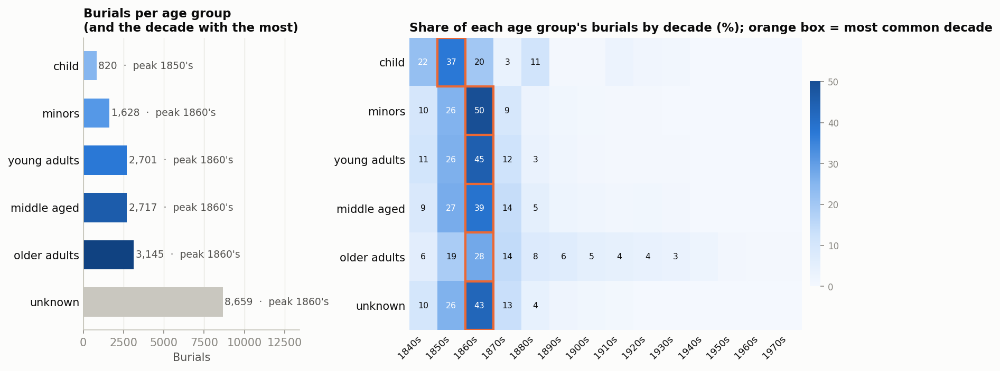
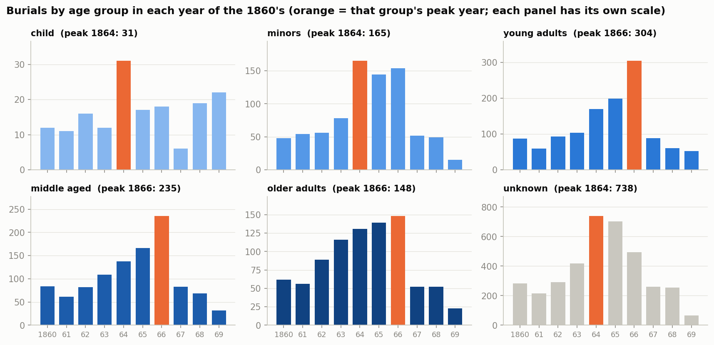

# Nashville City Cemetery, 1846–1979: reading a burial ledger with an AI pair programmer

**Juan Zavala** · AI for Analytics · `cause_of_death` assignment

The City of Nashville's interment ledger has 19,745 entries for burials in the Nashville City Cemetery from 1846 to 1979, written by hand by cemetery clerks. That is 19,670 burials once 75 duplicate entries are removed. This folder does four things:

- cleans the ledger;
- answers the assignment's nine questions in one notebook;
- builds a Power BI kit;
- builds an interactive dashboard.

The assignment is also about where an AI assistant saves time and where it needs a human to check it. So every answer in the notebook carries its own checks, and the claims that matter are enforced by `assert` statements.



*The dashboard is `cemetery_dashboard.html`. Download it and open it in any browser. The charts and headline numbers follow the filters, and you can drag across the year chart to pick years.*

## Key findings

- **Messy text becomes clean labels.** Across the 19,670 burials, the cause-of-death column has 2,209 distinct spellings ("Cholrea", "Consumson", "Teethin"). Explicit, tested rules turn them into 230 labels, and 99.3% of burials are labeled by a rule rather than left as written. Diseases that only share a word stay apart: *Cholera*, *Cholera Morbus* and *Cholera Infantum* are three different labels, and *Yellow Jaundice* is not *Yellow Fever*.
- **Tuberculosis ("consumption") is the leading known cause**, with 1,843 burials. That is 10.6% of the burials with a known cause.
- **Seven years spike: 1849, 1850, 1863, 1864, 1865, 1866 and 1873.** Cholera burials make up most of the extra burials in 1849–50 and 1866, and half of them in 1873. The Civil War years 1863–65 have no cholera. Their leading named causes were consumption, pneumonia, measles and whooping cough, and the rise fell most on Black Nashvillians: Black burials went from 140 in 1861 to 725 in 1864 and 770 in 1865.
- **The war changed who was buried, mostly among Black Nashvillians.** Black burials nearly tripled, with more minors and fewer older adults, so their median recorded age fell from 35 to 27. The median for White burials stayed at 32. The share of young men did not rise, which it would have if soldiers drove the spike.
- **"Unknown" age mostly means a baby.** 44.0% of burials have no age written, and 89.5% of those are entries like "Infant" or "Still born" or have an infant cause such as teething. The age-group results only make sense with that in mind.

## The nine questions at a glance

| # | Question | Short answer |
|---|---|---|
| 1 | Clean and group the cause of death | 2,209 spellings become 230 labels in the new `Cause of Death Updated` column. The 18 judgment calls are listed for review |
| 2 | Top 10 known causes | Tuberculosis, stillborn, cholera and pneumonia lead. Together the top 10 cover 51.1% of known causes |
| 3 | Spike years, and does Claude's explanation hold up? | 1849, 1850, 1863, 1864, 1865, 1866 and 1873. Cholera explains most of 1849–50 and 1866, and half of 1873; 1863–65 are the war years. The cholera counts were recounted from the raw text |
| 4 | Did the Civil War change the age of those buried? | For Black burials, yes (median 35 → 27); for White burials, no (median 32 → 32). The share of young men did not rise |
| 5 | Add a `decade` column | Added right after `Burial Year`, in the format `1840's`. The 1860's is the busiest decade (39.9% of burials) |
| 6 | Add an `age group` column | Added right after `Age`, using the exact labels. 44.0% of burials are "unknown", and most of those are infants |
| 7 | Burials and the most common decade for each age group | Five groups peak in the 1860's. "Child" peaks in the 1850's, because clerks stopped writing infants' ages |
| 8 | Burials by age group for each year of the 1860's | The young groups peak in 1864, the adults in 1866 (the cholera year). 1869 is likely a gap in the records |
| 9 | Power BI dashboard | `powerbi/` holds a star schema, DAX measures, a theme and a build guide. There is also a working web prototype |

## Question 1. Cleaning and grouping the cause of death



**How it works.** `cause_of_death_rules.py` holds the cleaning as readable data:
1. A normalizer.
2. A spelling dictionary.
3. An ordered list of `(label, pattern)` rules. The earliest match in the text wins, except that *Cancer* wins anywhere.

A value that no rule matches keeps its corrected spelling instead of being forced into a group. That covers 144 rows, such as "Piles" or "Locomotor Ataxia". The full raw → updated table is in `results/cause_mapping.csv`.

**What is checked with asserts:**
- The assignment's own examples: liver and lung cancer → *Cancer*; heart disease and heart attack → *Heart Disease*.
- Scarlet fever and yellow fever never share a label. Neither do smallpox and chicken pox, or the three cholera labels.
- The new column sits immediately right of `Cause of Death/Burial`.

**Decided from the data, not guessed.** "S. Feever" has a median recorded age of 7, like scarlet fever (6). "T. Feever" has a median of 19, like typhoid (20). And 99% of "summer complaint" burials are infants, so it is grouped with cholera infantum.

**Why fuzzy matching was not allowed to choose the groups.** The notebook tests the common shortcut: match each entry to the closest category name by string similarity, using difflib's default cutoff. Against the 99 modern category names it gets 8 of 18 test entries right (the plain typos). It puts 6 under the wrong disease and finds no match for 4:
- "Consumson" (consumption, that is tuberculosis) → *Convulsions*
- "Yallow Janders" (jaundice) → *Yellow Fever*
- "Child Bed Fever" (a childbirth death) → *Typhoid Fever*
- "Flux" (dysentery) and "Lockjaw" (tetanus) → no match

Adding the period names ("consumption", "flux"…) as candidates gets 16 of 18 right. But that works only because a person supplied them, and "Yallow Janders" and "Lung Fever" still land on the wrong disease. So no grouping is left to string similarity: every grouping is an explicit, readable rule. The 18 judgment calls, such as *summer complaint → cholera infantum*, *phthisic kept separate* and *flux = dysentery*, are listed in the notebook for Juan to confirm.

## Question 2. Top 10 known causes



Of 19,670 burials, 17,402 have a known cause. "Unknown" covers blanks, "not known" and notes that are not causes. *Complications (unspecified)* makes the top 10 but names no disease, so it is shown in gray. Lists from other students may differ because of grouping choices, because *Stillborn* and *Old Age* are kept as causes here, and because duplicates were removed. The table is in `results/top10_causes.csv`.

## Question 3. Spike years, and does the explanation hold up?



**The rule.** A year is a spike when its burials are at least **1.5×** the median of the five years before it **and** at least **50** more than that median. A local baseline is needed because the cemetery's volume falls by 94% from the 1860's to the 1890's.

| Year | Burials | Baseline | Cholera | Black burials | Reading |
|---|---|---|---|---|---|
| 1849 | 745 | 447 | 305 (41%) | 224 | Cholera |
| 1850 | 809 | 461.5 | 300 (37%) | 237 | Cholera |
| 1863 | 836 | 482 | 0 | 356 | War years |
| 1864 | 1,372 | 575 | 0 | 725 | War years (measles took 112) |
| 1865 | 1,366 | 627 | 0 | 770 | War years |
| 1866 | 1,354 | 836 | 388 (29%) | 804 | Cholera, on top of the wartime level |
| 1873 | 559 | 285 | 137 (25%) | 184 | Cholera |

**Does the explanation make sense? Yes, with one correction.**
- **Cholera is big enough to explain the cholera years.** In 1849, cholera burials alone (305) exceed the extra burials above the baseline (298). Cholera also accounts for 86% of 1850's extra burials, 75% of 1866's and 50% of 1873's.
- **The correction: the war years are not young soldiers.** The leading named causes are consumption, pneumonia, measles and whooping cough, which spread in crowded camps, and the increase falls mostly on Black burials. Wounds do appear (gunshot burials rose from 12 in 1856–60 to 61 in 1861–65, almost all men), but they are 1.3% of the war years' burials.
- **Do the numbers make sense? Yes.** Each quoted cholera count was recomputed straight from the raw text, independently of the cleaning rules, and the two counts agree for every year quoted (asserted).

**What needs a human.**
- The decline after 1870 is not evidence of falling mortality. Most likely burials moved to newer cemeteries, but that is general knowledge, not something the ledger shows. After 1900 no year has more than 41 burials.
- 1869 has only 209 burials. Infant entries fall to 52, which is 25% of the year's burials, against 51% in 1868. It is likely a gap in the records.
- The historical context is from Claude's general knowledge and is labeled as unverified, because this session had no web access:
  - the cholera waves of 1849–50, 1854, 1866 and 1873;
  - the Union occupation of Nashville from 1862;
  - people escaping slavery crowding into the city.

## Question 4. The Civil War and the age of those buried



| Median recorded age (bootstrap 95% CI) | Before (1856–60) | War (1861–65) | After (1866–70) |
|---|---|---|---|
| All burials | 33 (31–35) | 30 (28–30) | 30 (28–30) |
| White | 32 (30–34) | 32 (30–34) | 31 (30–33) |
| Black | 35 (31–40) | 27 (25–28) | 28 (26–30) |

- **The expected story was wrong.** The young-adult share did not rise during the war (14.2% → 13.4%), and neither did the share of men among young adults (46% → 44%). Young adults' numbers rose with everyone else's, but not faster.
- **The change is among Black burials.** They nearly tripled (741 → 2,188), and their median age fell because more were minors (6–17: 9.6% → 13.2%) and fewer were older adults (16.7% → 10.2%).
- **After the war, young adults rose to 18.9% of burials.** Two things contribute. The 1866 cholera caused 43% of that year's young-adult burials; without the 1866 cholera burials the share is 16.6%. And there were fewer infant entries in the mix, so more burials have an age written (58.5% against 49.2%). The two overlap, because the 1866 cholera burials mostly have an age. A smaller rise remains even after both.
- **Caution:** about half of these burials have no age written, and most of those are infants. The medians describe the people whose age was recorded.

## Questions 5 and 6. The `decade` and `age group` columns

`results/cemetery_clean.csv` is the cleaned ledger with the three new columns placed where the assignment asks:
- `Cause of Death Updated` right after `Cause of Death/Burial`;
- `decade` right after `Burial Year`, for example `1840's`;
- `age group` right after `Age`.

The age groups use the assignment's exact labels and bins: child ≤ 5, minors 6–17, young adults 18–30, middle aged 31–50, older adults over 50, and unknown when blank. Every boundary is tested.

**The literal rule hides most of the babies.** 8,659 burials (44.0%) have no age, and 89.5% of those (7,747) are infant-like entries. Only 820 burials land in "child". The column follows the rule as written; the analysis reads "unknown" as mostly infants.

## Question 7. Burials and the most common decade for each age group



- **Five of the six groups peak in the 1860's.** That is mostly volume: the 1860's holds 39.9% of all burials. The heatmap of row shares is more informative than the raw peaks.
- **"Child" peaks in the 1850's (37.4% of the group).** This is record keeping. Clerks wrote an age for 10.3% of infant-named entries in the 1840's, but for only 0.4% in the 1860's, so the babies of the 1860's sit in "unknown".
- **Older adults have the longest tail.** 33.7% of their burials are from 1880 or later, against 6.5% for young adults. Older family members going into existing family lots would explain it, but that reading is not proven.

## Question 8. Burials by age group in each year of the 1860's



- **The peaks split by age.** Children, minors and the unknown (mostly infant) group peak in **1864**. Measles was the leading named cause that year for recorded children (23%) and unknown-age burials (11%), though it explains only part of the rise. The adult groups peak in **1866**, the cholera year: cholera caused 43% of young-adult burials.
- **The wartime rise is broad, not a young-men surge.** Every group is higher in 1864–65 than in 1860.
- **1869 is odd.** Total burials fall to 209, and the unknown group collapses from 255 to 65, while recorded children barely change (19 → 22). Infant entries seem to be missing, so the 1869 volume is likely incomplete.

## Question 9. The Power BI dashboard

Power BI Desktop is Windows-only, and this was built on a Mac. So the kit is ready to build from, and the same design runs as a web prototype:

| File | What it is |
|---|---|
| `powerbi/fact_burials.csv`, `dim_year.csv`, `dim_age_group.csv`, `dim_cause.csv` | A star schema written by the notebook: one row per burial, all 134 years, and the 230 cause labels grouped into 14 cause families plus Unknown |
| `powerbi/measures.dax` | All the measures as one DAX query. Running it lists the spike years and headline numbers to check against the notebook, then **Update model with changes** saves the measures |
| `powerbi/theme.json` | The same colors as the notebook charts |
| `powerbi/BUILD_GUIDE.md` | Step by step: load, relate, measures, theme, two report pages, and a checklist |
| `cemetery_dashboard.html` | The interactive prototype, a single file that works offline. With no filters its numbers match the notebook: totals, spike years, top 10, most common decades, the 1860's table and the Civil War medians were all checked in a browser |

Claude can't run Power BI, so the DAX has not been executed yet. Running `measures.dax` is step 3 of the build guide, and it should list the seven spike years.

## Where the AI saved time, and where it needed a human

| Step | Where Claude saved time | Where a human had to check |
|---|---|---|
| Cleaning causes | Turned 2,209 spellings into 230 labels with written, tested rules | **Medical meaning.** String similarity merges diseases that only look alike, and period terms such as "phthisic" or "hives" have no single modern meaning. The 18 judgment calls are listed for review |
| Spikes | Detected spikes with a local baseline, and recounted the cholera numbers from the raw text | **Source limits.** A cemetery is not the city, 1869 is likely incomplete, and the historical context is unverified |
| Civil War and age | Built the period, race and age comparison with confidence intervals | **The expected "young soldiers" story was wrong.** The data had to overrule general knowledge |
| Age groups | Built the columns exactly as specified, with every boundary tested | **A literal rule can hide the story.** "Blank = unknown" turns most infants into "unknown" |
| Power BI | Built the data model, the measures, the theme and a working prototype | **It can't click through Power BI.** The final build and its visual check are Juan's |

Even the source needs checking. The ledger records former President James K. Polk at age 64 with cause "Complicated", while standard accounts give 53 and cholera. Those accounts were not checked here, because this session had no web access.

## Data notes

- **Source.** Historic Nashville City Cemetery Interments, 1846–1979, published by the City of Nashville and linked from the assignment. The copy used here is in `data/`, and the notebook refuses to run if its checksum changes.
- **Duplicates.** 75 duplicate entries were removed. All are lettered-book copies of 1879–1881 burials that already appear in a yearly book, and they are listed in `results/duplicates_removed.csv`. Placeholder names such as "Infant" are never treated as duplicates.
- **One cemetery, not the city.** These are burials here, not deaths across Nashville. 76.5% of all burials happened before 1871. After that, most likely newer cemeteries took most burials (general knowledge, not shown in the ledger).
- **Race codes.** The ledger mostly uses `W` and `B`. `D` appears only in 1869 (69 rows). A few rows are blank or use other codes, such as `C` or "Cold", which probably mean "colored". In 1869 only 31 burials are coded `B`, against 305 in 1868, so `D` may stand for Black there. The notebook leaves all of these as "other"; that is a judgment call to confirm.

## How to run it

```bash
cd submissions/juan_zavala
python -m pip install -r requirements.txt
```

1. Open `cemetery_analysis.ipynb` in VS Code or Jupyter and **Run All**. It takes about 15 seconds and rewrites everything in `results/`, `images/` and the CSV files in `powerbi/`. If any checked number changes, it stops with an `AssertionError`.
2. Run `python dashboard_src/build_dashboard.py` to rebuild `cemetery_dashboard.html` from the fresh results.

The notebook needs only pandas, numpy and matplotlib. It gives identical results under Python 3.9 (pandas 2.3.3, numpy 2.0.2, matplotlib 3.9.4) and Python 3.10 (pandas 2.3.3, numpy 2.2.6, matplotlib 3.10.9).

## What's in this folder

```
cemetery_analysis.ipynb      the analysis: Questions 1-9, each with its checks
cause_of_death_rules.py      spelling dictionary and grouping rules (used by Question 1)
cemetery_dashboard.html      interactive dashboard prototype (open in a browser)
data/                        the raw ledger (unchanged) and its description
results/                     cemetery_clean.csv (with the 3 new columns), cause_mapping.csv,
                             one table per question, dashboard_data.json, facts.json
images/                      the charts used above
powerbi/                     data model, measures.dax, theme.json, BUILD_GUIDE.md
dashboard_src/               source and build script for the dashboard
requirements.txt
```

The statistics in this README are filled in from the notebook's own outputs (`results/facts.json` and `results/spike_years.csv`), so they match the notebook.
